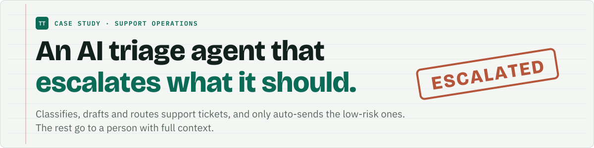
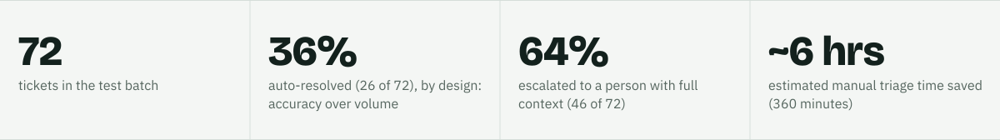
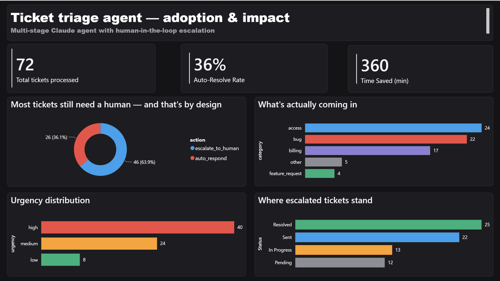

<picture>
  <source media="(prefers-color-scheme: dark)" srcset="assets/banner-dark.svg">
  
</picture>

<p>
<a href="https://ebrahimtahirr.github.io/ap-agent-site/">
<picture>
  <source media="(prefers-color-scheme: dark)" srcset="assets/btn-ap-case-study-dark.svg">
  
</picture>
</a>
</p>

<picture>
  <source media="(prefers-color-scheme: dark)" srcset="assets/stats-dark.svg">
  
</picture>

## Problem

Support teams get a mixed inbox: simple, repetitive questions with a known answer sitting next to urgent, ambiguous or emotionally charged tickets that need a person. Without a system to sort them, every ticket costs the same attention and urgent issues can sit behind routine ones.

Separately, most AI automation pilots do not fail because the model is bad. They fail because nobody builds the layer that proves the AI is working after deployment, so confidence fades and the pilot quietly dies. This project does both: it automates the triage decision and it measures whether that decision is trustworthy.

## Approach

```
Raw ticket
   |
   v
1. Classify        Claude reads the ticket: category, urgency, sentiment
   |
   v
2. Retrieve/Draft  Claude checks it against a small FAQ knowledge base and decides:
   |               does this FAQ actually resolve the question, or only share a topic?
   v
3. Route (no AI)   low risk + FAQ match + not urgent -> auto-send
   |               anything else                     -> escalate to a human
   v
Audit trail (every run, both branches) -> live Power BI dashboard
```

**Stage 1, classify.** Claude returns structured JSON: category, urgency, sentiment and a one-sentence summary, at temperature 0.2 because this needs consistency, not creativity.

**Stage 2, retrieve and draft.** Claude checks the ticket against five FAQ topics (password reset, billing and payment, data export, feature access by plan, subscription changes). It must tell topical overlap apart from the FAQ actually resolving the specific question. Output: whether it matched, the action to take, and either a customer-facing draft or an internal handoff summary.

**Stage 3, route.** No AI here, only a conditional on the `action` field from stage 2. Auto-respond cases are sent by email. Escalations post a Slack alert with full context. Every run is logged.

### The key decision: risk-tiered, not blanket, automation

Only tickets that are both low risk (cleanly FAQ-matched) and non-urgent are sent without review. Anything ambiguous, urgent or outside the FAQ's real scope goes to a human, even if it superficially matched a topic.

This came from a real bug caught in testing: a ticket asking *why* a payment was declined matched the "update your payment method" FAQ by topic, but that FAQ does not answer "why". The matching rule was tightened so a match requires the FAQ to resolve the specific question.

### Testing infrastructure

A second workflow generates synthetic test tickets with Claude, using an explicit quota in the prompt (a fixed number of low, medium and high urgency tickets, split by FAQ match and no match). A vague "add some variety" instruction produced skewed batches. The batch runs through the full agent with an n8n Loop Over Items and Execute Sub-workflow pattern, in one click.

## Result

From a 72-ticket test batch:

| Metric | Result |
|---|---|
| Tickets processed | 72 |
| Auto-resolved | 26 (36%) |
| Escalated with full context | 46 (64%) |
| Estimated manual triage time saved | about 6 hours (360 minutes) |

The auto-resolution rate was not tuned upward. Accuracy was prioritized over volume.

The Power BI dashboard is connected live to the same Google Sheets audit trail the agent writes to, so running more tickets and refreshing updates it immediately. It shows volume, the auto-resolve and escalate split, category and urgency breakdowns and, the key piece, what happened to tickets after the fact (resolved, in progress, pending). That last view is what turns "an AI tool" into evidence that the tool is trusted and used.

## Stack

- **Claude API** (Claude Haiku 4.5): classification and drafting, structured JSON output
- **n8n**: workflow orchestration, sub-workflow and loop patterns, webhook triggers
- **Google Sheets**: live audit-trail data layer
- **Power BI**: live-connected dashboard, DAX measures, Power Query cleaning
- **Slack**: escalation alerts via webhook
- **Gmail**: automated send for low-risk resolutions

## Screenshots

<p></p>
<sub>The Power BI dashboard on the audit trail of the 72-ticket batch.</sub>

## How to run

1. In n8n, import both files from `Workflows/`: `Ticket Triage.json` (the agent) and `Ticket Batch Tester.json` (the synthetic ticket generator and loop).
2. Add credentials for Anthropic, Google Sheets and Gmail.
3. In `Ticket Triage`, replace the placeholder Slack webhook URL, replace `YOUR_SHEET_ID` in the two Google Sheets nodes with your own sheet, and replace `you@example.com` in the Gmail node with the address that should receive the replies.
4. In `Ticket Batch Tester`, select your imported `Ticket Triage` workflow in the Execute Sub-workflow node, then run it to push a test batch through.
5. Connect Power BI to the Google Sheet to rebuild the dashboard.

### In a real deployment

This prototype uses a manual or batch trigger and Gmail and Sheets as stand-ins. In production the entry point would be a live inbox trigger or a webhook from the company's helpdesk (Zendesk, Freshdesk, Intercom, Jira Service Management), and replies and escalations would write back through that platform's API. The reasoning core (classify, retrieve and draft, route) does not change; only the way in and the way out do.

## Lessons from building this

- Vague prompt instructions ("include a mix") do not reliably produce balanced test data. Explicit quotas do.
- Output requested as raw JSON can still arrive wrapped in markdown fences. Build defensive parsing (strip fences, validate, fall back) from the start.
- The most valuable decision was not a prompt or a node. It was deciding which class of tickets the AI should never act on alone.
